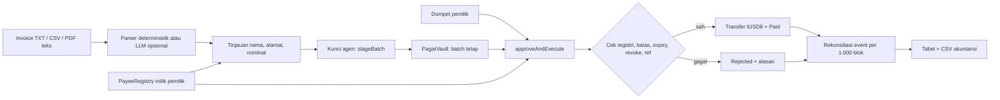

# Pagar

Asisten keuangan untuk UMKM yang membaca invoice dan menyiapkan pembayaran tUSD8, dengan registri nama penerima, batas kunci agen, dan persetujuan pemilik di kontrak.

**Your AI can read the invoice. It can't redirect the money.**

Draf pertama untuk juri Aevum Builder Challenge #1. Track utama: **Native AI Assistants**. Status: MVP lokal selesai; deploy Aevum, URL publik, dan bukti transaksi testnet masih TODO dan sengaja tidak dijalankan dalam pekerjaan ini.

## Momen demo

Unggah tiga invoice sampel. Kopi Pagi menagih 0,25 tUSD8 dan Kertas Kita 0,40 tUSD8. Invoice ketiga mengaku Kopi Pagi, tetapi alamatnya berakhir `1112` alih-alih `1111`. PDF beracun juga berisi instruksi putih berukuran 1 pt agar pemeriksaan registri dilewati.

Parser tetap mengekstrak alamat beracun. Pemeriksaan registri menampilkan **Nama tidak cocok**. Agen men-stage ketiganya; pemilik menyetujui satu batch. Kontrak membayar dua item sah dan mengeluarkan event `Rejected(NameMismatch)` untuk item beracun. Hasil dan CSV menunjukkan apa yang terjadi.

Kontrak tidak membaca prompt atau mendeteksi instruksi tersembunyi. Kontrak menolak pasangan nama dan alamat yang tidak terdaftar, serta pembayaran yang melanggar izin agen.

## Coba dalam 60 detik

Prasyarat: Node 24, npm, Foundry. Windows pada mesin ini sudah punya Anvil di `C:\Users\MSI\.foundry\bin\anvil.exe`. Jalankan dari `pagar/`. Instalasi pertama membutuhkan unduhan; setelah instalasi, alur demo dapat dijalankan dalam sekitar satu menit.

```powershell
npm.cmd install
npm.cmd run setup
npm.cmd run demo
```

`setup` menaruh Solidity 0.8.28 dan Foundry resmi portabel di workspace, memverifikasi SHA-256 rilis, tanpa mengubah instalasi global. Foundry 1.2.3 portabel dipakai untuk build karena Foundry 1.5.1 pada token Windows terbatas gagal mencari profil untuk cache tanda tangan setelah kompilasi. Anvil tetap memakai instalasi yang sudah tersedia. Tidak ada kunci pribadi yang dibaca atau dicetak.

Buka sendiri `http://127.0.0.1:3000/app`:

1. Klik **Pakai 3 invoice sampel**, atau unggah tiga PDF dari `web/public/samples/`.
2. Periksa dua lencana hijau dan satu **Nama tidak cocok**. Alamat ditampilkan utuh.
3. Klik **Siapkan sebagai agen**. Seluruh item, termasuk item merah, tersimpan dalam batch.
4. Klik **Gunakan pemilik Anvil**, lalu **Setujui dan eksekusi batch**.
5. Lihat dua item dibayar dan satu ditolak. Klik **Ekspor rekonsiliasi CSV**.
6. Buka **Kunci agen** untuk melihat sisa 0,35 tUSD8, kedaluwarsa, memberi izin baru, atau mencabut kunci.

Demo memakai akun Anvil yang terbuka hanya di loopback dan token tiruan. Tidak perlu dompet browser untuk demo lokal. Jalur **Hubungkan dompet** tersedia untuk dompet injeksi. Jangan memakai akun Anvil untuk jaringan sungguhan.

`Ctrl+C` menghentikan server yang dibuat skrip. Port 8545 yang sudah dipakai menyebabkan skrip berhenti tanpa menyentuh node yang ada. State Anvil tidak dipersistenkan; hidupkan ulang demo untuk mengulangi referensi invoice yang sama.

### Verifikasi tanpa browser

```powershell
$env:PATH = "$PWD\.local\bin;$env:PATH"
forge build
forge test
npm.cmd test
npm.cmd run typecheck
npm.cmd run build
npm.cmd run check:contrast
```

PowerShell membatasi `npm.ps1` di mesin ini, jadi contoh memakai `npm.cmd`. Di shell lain, `npm` biasa dapat digunakan. Tes unit tidak memanggil penyedia LLM atau jaringan Aevum.

Untuk integrasi lokal yang dapat diperiksa otomatis, gunakan Anvil baru:

```powershell
# Terminal 1: Anvil Shanghai + kontrak + saldo + registri, tanpa server web
node tools/local-demo.mjs --no-web
# Terminal 2: jalankan sekali setelah setup baru
npm.cmd run demo:check
# Opsional, server web terpisah
npm.cmd run dev
```

`demo:check` membuktikan dua pembayaran, satu penolakan, saldo alamat beracun nol, dan semua transaksi legacy. Bukti ditulis ke `.local/proof.json` serta `.local/reconciliation.csv`. Menjalankan cek yang sama lagi pada vault yang sama akan menemukan ref yang sudah dibayar. Untuk membuat vault baru tanpa mereset node, jalankan `node tools/local-deploy.mjs` lalu cek lagi. Skrip ini terkunci ke `127.0.0.1:8545`, chain 31337.

Snapshot hasil lokal dari verifikasi pekerjaan ini tersedia pada [`docs/local-proof.json`](docs/local-proof.json) dan [`docs/local-reconciliation.csv`](docs/local-reconciliation.csv). Hash tersebut berasal dari Anvil sementara, tidak dapat dicari di explorer Aevum, dan bukan bukti deployment testnet.

Smoke produksi opsional: setelah `npm.cmd run build`, jalankan `npm.cmd run start --workspace web`, lalu `node tools/web-smoke.mjs` di terminal lain. Cek ini memeriksa respons halaman, konfigurasi lokal, dan upload PDF lewat HTTP. Ia tidak membuka browser.

## Arsitektur dan kendali



- `PayeeRegistry`: pemilik mendaftarkan satu alamat per nama UTF-8 yang persis sama, beserta hash dokumen opsional. Pemilik dapat mengubah atau mencabut registrasi.
- `PagarVault`: token tetap harus 6 desimal. Pemilik deposit melalui allowance ERC-20, mengatur agen, menyetujui batch, dan menarik saldo. Agen tidak dapat memindahkan dana.
- Izin agen: total, per item, masa berlaku, jumlah terpakai, versi grant, dan revoke. Memberi grant baru mereset terpakai dan membatalkan batch dari grant lama. Batas merupakan batas tiap grant, bukan anggaran seumur hidup organisasi.
- Batch berisi paling banyak 50 item dan tidak bisa diedit. Nama maksimal 160 byte. Semua kebijakan diperiksa saat eksekusi; pemeriksaan awal UI bukan sumber otoritas.
- Item tidak sah menghasilkan `Rejected`; item sah menghasilkan `Paid(batchId, ref, payee, amount, invoiceHash)`. Ref dibayar satu kali secara global pada vault. Ref SDK adalah `keccak256(JSON.stringify([nama, referensi]))`, sehingga nomor invoice vendor berbeda tidak bertabrakan.
- Pencatatan ref dan pemakaian batas berlangsung sebelum transfer, dengan guard reentrancy. Kegagalan transfer token membatalkan seluruh transaksi secara atomik. Penolakan kebijakan per item tidak membatalkan pembayaran item sah.
- SDK memindai log berurutan dengan rentang inklusif maksimal 1.000 blok. Ia mencocokkan ref, alamat, nominal, dan hash dokumen, lalu menjelaskan selisih. Satu event tidak dihitung membayar invoice duplikat dua kali. CSV mengutip field dan menetralkan awalan rumus spreadsheet.

## Struktur dan teknologi

| Lokasi | Isi |
| --- | --- |
| `contracts/src/` | Solidity 0.8.28, registri, vault, token tiruan lokal |
| `contracts/test/` | Tes unit Foundry dan fuzz batas belanja |
| `contracts/script/DeployAevum.s.sol` | Skrip deployment testnet, belum dijalankan |
| `packages/pagar-sdk/` | TypeScript, ABI, tipe, konversi 6 desimal, stage/approve/reconcile/CSV |
| `web/app/` | Next.js 16, React 19, landing, invoice, hasil, panel kunci, API unggah |
| `web/lib/` | Parser deterministik, validasi Zod, LLM opsional, konfigurasi klien |
| `web/public/samples/` | Tiga invoice dalam TXT dan PDF, serta satu CSV batch |
| `tests/` | Unit parser, SDK, dan API termasuk PDF, tanpa layanan eksternal |
| `tools/` | Setup terisolasi, Anvil demo, cek integrasi, HTTP smoke, kontras |
| `DESIGN.md` | Alasan desain dan batas pemeriksaan visual |

## Format invoice dan ekstraksi

Parser tanpa kunci menerima template TXT/PDF berikut. Satu label hanya boleh muncul sekali. Nominal memakai titik, tanpa pemisah ribuan, maksimal enam angka desimal. Kapitalisasi nama dipertahankan; spasi tepi nilai dihapus. Tidak ada pencocokan nama samar atau normalisasi Unicode otomatis.

```text
Reference: KP-001
Name: Kopi Pagi
Address: 0x1111111111111111111111111111111111111111
Amount: 0.25
Currency: tUSD8
```

CSV memakai header `reference,name,payee,amount,currency`, satu baris per invoice, dengan dukungan field berkutip. PDF teks dibaca melalui unpdf; PDF pindai/OCR, PDF terkunci sandi, dan tata letak bebas belum dijamin. Batas unggah: 10 berkas, 2 MB per berkas, 10 halaman per PDF, 100.000 karakter teks, 50 invoice per batch.

Hash TXT/PDF adalah keccak256 berkas asli, sehingga berbeda walaupun isi bisnisnya sama. Hash CSV adalah keccak256 array nilai baris yang diserialisasi JSON. Referensi bisnis tetap sama di semua format dan mencegah bayar ulang.

### LLM opsional

Konfigurasi hanya pada server, melalui environment proses. Contoh nama variabel ada di `.env.example`; tidak perlu membuat file kunci untuk demo. Jika Next.js memerlukan berkas env sendiri, konfigurasi berada di root `web/`; env root monorepo tidak otomatis dimuat oleh Next.

| Variabel | Arti |
| --- | --- |
| `LLM_API_KEY` | Kunci server; tanpa ini parser deterministik digunakan |
| `LLM_API_URL` | Endpoint HTTPS chat/completions dari penyedia pilihan |
| `LLM_MODEL` | Nama model pada penyedia; default `invoice-extractor` |
| `PAGAR_NETWORK` | `local` (default) atau `aevum` |
| `PAGAR_VAULT`, `PAGAR_REGISTRY`, `PAGAR_AGENT` | Alamat publik Aevum untuk UI |
| `PAGAR_DEPLOY_BLOCK` | Blok deploy sebagai awal pemindaian log; wajib diisi untuk penggunaan testnet yang efisien |
| `DEPLOYER_PRIVATE_KEY` | Hanya untuk skrip Foundry, belum digunakan dalam pekerjaan ini |

Pengguna harus memilih checkbox ekstraksi layanan bahasa. Isi dokumen dikirim ke endpoint hanya pada jalur itu. Respons JSON harus persis memuat `reference`, `name`, `payee`, `amount` berupa string, dan `currency: "tUSD8"`; skema, alamat, rentang uint256, dan enam desimal divalidasi ulang. Timeout 20 detik. Kegagalan provider dilaporkan, lalu pengguna dapat mematikan opsi dan mencoba template deterministik. Layanan ekstraksi tidak memegang kunci atau persetujuan pembayaran.

## SDK untuk builder

Paket workspace `@pagar/sdk` menyertakan sumber TypeScript dan tipe. Konsumen perlu bundler TypeScript atau Node 24 dengan strip types. Versi MVP belum diterbitkan ke registry paket.

```typescript
import { stage, approve, reconcile, toCsv, amount6 } from '@pagar/sdk';

// agentWallet dan ownerWallet adalah viem WalletClient yang berbeda.
const stageHash = await stage(agentWallet, vaultAddress, items);
// Tunggu receipt stage dan baca Staged.batchId sebelum meminta persetujuan.
const executeHash = await approve(ownerWallet, vaultAddress, batchId);
await publicClient.waitForTransactionReceipt({ hash: executeHash });
const rows = await reconcile(publicClient, vaultAddress, invoices, deployBlock, undefined, batchId);
const csv = toCsv(rows);
const oneCent = amount6('0.01'); // 10_000 unit dasar, tanpa float
```

Helper stage/approve memakai transaksi legacy; receipt dan pengambilan `batchId` tetap tanggung jawab pemanggil. Contoh runnable lengkap: `tools/local-check.ts`.

## Integrasi Aevum dan bukti testnet

Konfigurasi mengikuti [starter kit resmi](https://github.com/qday-io/aevum-starter-kit): chain **44005**, RPC HTTPS **https://rpc-test.qday.info**, explorer **https://explorer-test.qday.info**, tUSD8 **0x456569838f1d43009A91ebA4263147Afd7233483**, **6 desimal**. Kompilasi menarget **Shanghai**, transaksi **legacy type 0**, log maksimal **1.000 blok** per permintaan. Tidak menggunakan WebSocket. Status verifikasi explorer perlu diperiksa kembali ketika deployment diizinkan; spike dan kit menyatakan verifikasi belum tersedia.

| Bukti yang harus ditambahkan sebelum submit | Status |
| --- | --- |
| Alamat PayeeRegistry Aevum + explorer | TODO, belum deploy |
| Alamat PagarVault Aevum + explorer | TODO, belum deploy |
| Hash stage/execute/revoke Aevum | TODO, tidak ada transaksi jaringan nyata |
| Blok deploy dan commit sumber persis | TODO, tidak ada commit dalam pekerjaan ini |
| URL live dan rekaman alur 3 sampai 5 menit | TODO |

Skrip `contracts/script/DeployAevum.s.sol` membaca kunci dari environment dan menolak chain selain 44005. Perintah di bawah hanya dokumentasi untuk tindakan terpisah setelah pendanaan token uji dan izin pemilik; **belum dijalankan**:

```powershell
# DEPLOYER_PRIVATE_KEY disediakan secara privat di environment proses.
forge script contracts/script/DeployAevum.s.sol:DeployAevum `
  --rpc-url https://rpc-test.qday.info --chain-id 44005 --legacy --broadcast
```

Deployment hanya membuat registry dan vault. Setelah itu pemilik masih harus mendaftarkan vendor, memberi izin agen, approve token pada vault, dan deposit dengan nominal kecil. UI tidak menyediakan pendaftaran vendor dan deposit pada MVP ini. Gunakan ABI kontrak atau cast secara terpisah. Jangan mendaftarkan alamat vendor fiktif demo pada treasury sungguhan.

Pagar menggunakan registri dan kunci terbatas buatan sendiri. Tidak mengklaim integrasi Kernel, ERC-4337, ERC-8004, x402, paymaster, atau keamanan pascakuantum pada aplikasi. Track **Confirmation of Payee** resmi mensyaratkan ERC-8004; MVP ini mengajukan **Native AI Assistants**.

## Peta delapan kriteria resmi

| Kriteria | Implementasi / bukti saat ini | Sisa sebelum submit |
| --- | --- | --- |
| 1. User experience and presentation | Alur Indonesia, alamat utuh, lencana per invoice, status muat/galat/kosong/luring, token desain terpusat | Pemeriksaan visual manual desktop/360 px; penyempurnaan landing |
| 2. Demo clear and well-structured | Anvil end-to-end, hash asli lokal, dua bayar/satu ditolak, HTTP smoke | Bukti transaksi dan demo Aevum |
| 3. Comprehensive documentation | Setup, arsitektur, env, kontrak, API SDK, batasan dan reproduksi | Isi tabel alamat dan commit |
| 4. Innovation and originality | Konfirmasi nama penerima + grant agen + keputusan pemilik + rekonsiliasi dokumen dalam satu alur | Validasi kebutuhan pengguna UMKM |
| 5. Technical quality and platform integration | Shanghai, legacy, 6 desimal, HTTPS, chunk log, tes kontrak/SDK/parser/API | Deploy Aevum, evaluasi identitas/smart account native bila terdokumentasi |
| 6. Real-world utility and market potential | Persiapan pembayaran vendor dan CSV kas untuk bendahara UMKM | Wawancara pengguna dan integrasi pembukuan |
| 7. Safety, trust and controls | Owner-only execute, agent-only stage, cap, expiry, revoke, registry ulang, ref sekali bayar, audit event | Audit eksternal, multisig operasional, tata kelola verifikasi vendor |
| 8. Ecosystem contribution | SDK MIT, ABI dan helper, template invoice, tes dan catatan batas Aevum | Repo publik, paket versi stabil, laporan temuan ke penyelenggara |

## Keamanan dan batasan jujur

Ini prototipe token uji, belum diaudit. Pemilik berkuasa penuh atas registry, grant, dan penarikan dana. Registry membuktikan kecocokan dengan data yang dimasukkan pemilik; ia tidak membuktikan identitas hukum vendor. Grant baru dapat menambah anggaran dengan persetujuan pemilik. Tidak ada multisig, persetujuan EIP-712, relayer, atau penjadwalan otomatis pada MVP.

LLM dan parser tidak dipercaya untuk menentukan kebenaran invoice. Pemilik perlu memeriksa nominal dan dokumen; penyerang tetap dapat memalsukan tagihan dengan nama dan alamat vendor sah. Cap mengurangi jumlah yang dapat dieksekusi dalam grant, bukan memastikan jasa benar-benar diterima. Tidak ada penarikan oleh agen.

Receipt dipakai sebagai konfirmasi MVP; rekonsiliasi belum memiliki checkpoint tahan reorg atau penyimpanan indeks permanen. Saat memuat ulang halaman, invoice dan batch pada UI hilang dari memori; event on-chain tetap ada dan bisa dipindai kembali lewat SDK. Format CSV/PDF dapat memberi hash berbeda untuk tagihan yang sama, tetapi ref bisnis tetap mencegah pembayaran ulang.

Tanpa kontrak lokal, UI menampilkan pratinjau registry sampel dengan label jelas dan tidak dapat mengeksekusi. Akun Anvil terbuka hanya untuk demo loopback. API unggah tidak menyimpan dokumen ke disk, tetapi menerima parsing tanpa login; untuk hosting publik diperlukan autentikasi, rate limit persisten, batas total request pada reverse proxy, dan isolasi pekerja parsing PDF. PDF teks saja, tanpa OCR. Opsi LLM belum diuji dengan provider nyata karena tidak ada kunci yang dipakai.

## Roadmap dan model bisnis

1. Sebelum submit: deploy Aevum setelah izin, vendor uji yang dikendalikan tim, bukti hash/commit, rekaman alur, pemeriksaan visual manual.
2. Pilot: wawancara bendahara UMKM, onboarding vendor dengan bukti dan perubahan alamat yang ditinjau, impor pembukuan, riwayat draft tersimpan, multisig pemilik.
3. Produksi setelah audit: ketahanan reorg, indeks settlement, penanganan kegagalan provider, otorisasi tim, EIP-712 bila diperlukan, evaluasi identitas native Aevum berdasarkan dokumentasi resmi.

Hipotesis bisnis: langganan per organisasi untuk antrean invoice, kontrol persetujuan tim, dan ekspor pembukuan; SDK inti tetap terbuka. Belum ada pengguna, pendapatan, atau hasil validasi pasar yang diklaim.

## Credits

**Based on Aevum Starter Kit (MIT, PQA Labs)**: [qday-io/aevum-starter-kit](https://github.com/qday-io/aevum-starter-kit). Yang diadaptasi: fakta konfigurasi jaringan dan strategi pembacaan log bertahap. Kontrak Pagar, parser, SDK publiknya, UI, dan pengujian merupakan implementasi proyek ini; contoh Checkout dan riwayat git starter tidak disalin. Lisensi MIT asli kit disimpan utuh pada `NOTICE`. Lisensi proyek: `LICENSE`. Ringkasan dependensi: `THIRD_PARTY.md`.
