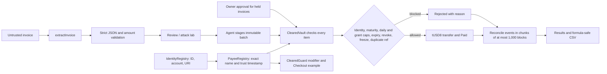

# Cleared

**Your AI can read the invoice. It can't redirect the money.**

Cleared is for **web3 teams and DAOs paying contractor invoices in stablecoins**. Mature verified recipients can be paid by an agent without an owner signature, within contract-enforced limits. New recipients and changed payment addresses are held for owner approval.


> Cleared lets an AI agent prepare and pay your stablecoin invoices, but the contract, not the AI, decides who can be paid: a poisoned invoice can fool the model and still can't move a cent to a lookalike.

Measured, not assumed: in 55 recorded live runs against the deployed site on 27 Nov 2026, the model followed a hidden instruction twice and extracted a lookalike address. Both times, the Aevum contract answered `Name mismatch`. Details and a script to rerun it: [docs/LIVE-MODEL-TEST.md](docs/LIVE-MODEL-TEST.md).

Aevum Builder Challenge #1, primary track: Native AI Assistants.

**Watch it run itself (90 seconds, simulation, no wallet):** https://cleared-ecru.vercel.app/try?demo=1. Clerk, the assistant, drives the real interface with a visible cursor across Try it, Attack lab, Treasury and Controls. You can pause, skip or exit at any time.

**Watch the 1:38 video:** https://youtu.be/O4x1mSt2NHw

Try it, no wallet: https://cleared-ecru.vercel.app/try · Attack it with a live model: https://cleared-ecru.vercel.app/attack

### Proof in 20 seconds

- **Deployed on Aevum testnet** (chain 44005, block 3380779): [ClearedVault](https://explorer-test.qday.info/address/0x8fba7dd67e294b3ba5ca164748b9f41c03bad13c) · [PayeeRegistry](https://explorer-test.qday.info/address/0xad297045531da0e71b9ecd3de215d2b63cb74e1d) · [IdentityRegistry](https://explorer-test.qday.info/address/0xBC4A33597D5f0faf11d157dE6dE74cD4E96E088f).
- **Same code as this repository:** `forge build && node tools/verify-bytecode.mjs` compares the live runtime bytecode, including the Solidity metadata hash, with your local build. The Aevum explorer's verifier currently lists no Solidity compilers, so this script is the reproducible check.
- **Every vault decision, no wallet:** the [Aevum ledger](https://cleared-ecru.vercel.app/app#ledger) lists the vault's Paid, Rejected (with reason), Staged, freeze and agent events, read from the public explorer API (with a public-RPC fallback and a frozen snapshot of past events, so the record stays readable when the explorer is down), with transaction links.
- **Seven payment scenarios on-chain** (Paid, PayeeOnHold, one batch with the verified contractor paid and its lookalike refused, owner approval, kill switch, key revoke): all seven verified on 18 Nov 2026 (run r202611181345), every receipt linked in [docs/TESTNET-PROOF.md](docs/TESTNET-PROOF.md). The batch that pays the verified contractor and refuses its lookalike in the same transaction: [0xddffc6c3…64e4](https://explorer-test.qday.info/tx/0xddffc6c3955e69fc5b991103c0d69a9a51cd22f23c84251f87155e78ac8464e4).

First commit: 17 Nov 2026

## Why this matters

Paying the wrong address is an old fraud with a new target. The FBI's 2024 Internet Crime Report counts **21,442 business email compromise complaints and $2,770,151,146 in reported losses** in one year: invoices and payment instructions quietly redirected to an attacker ([IC3 2024 report](https://www.ic3.gov/AnnualReport/Reports/2024_ic3report.pdf)). When an AI agent reads those invoices and pays them in stablecoins, a redirected address settles in seconds and cannot be recalled.

Spending caps answer *how much* an agent may pay. Cleared answers *to whom*: the contract pays only a name and address pair that is in the payee registry and has passed a 24-hour hold, whatever the model extracted.

**Pilot ask.** If you pay contractors from a DAO or web3 treasury, I would like 15 minutes: (1) how do you verify a contractor's address today, (2) how often does a payee change their address, (3) would a 24-hour hold on new or changed addresses be acceptable. Open an issue in this repository or reply on the DoraHacks BUIDL page.

## Tech stack

Solidity 0.8.28 + Foundry, Next.js, React, viem, pdf-lib, Vitest, Vercel, LLM adapters Gemini/Anthropic.

## Try without a wallet

Open **[the live /try demo](https://cleared-ecru.vercel.app/try)**. No wallet, API key or visitor installation is required. It loads three sample invoices automatically.

1. Simulate automatic payment: two mature contractors are allowed, the lookalike is rejected.
2. Select a new recipient or changed address. See **PayeeOnHold** and its remaining time. The agent cannot clear it; owner approval can.
3. Freeze demo payments with the kill switch. Both automatic and owner-approved payments are blocked.
4. Open **/attack**, choose a pre-generated lookalike and enable hidden instructions. Edit the invoice yourself.
5. Compare extracted fields with the payment decision. The local ledger reads **n attempts · n refused** from actual API outcomes, plus the simulated amount cleared. No transaction is sent. These are browser-local simulation totals, not public security metrics.

If public Aevum contract addresses are configured, /try also offers read-only contract checks using eth_call. They are separate from the sample simulation and produce no transaction receipt. RPC failures are shown as errors.

## Present the demo

See the [three-minute demo script, judge Q&A, rehearsal log and fallback ladder](docs/DEMO.md).

## Run locally

Requirements: Node 24, npm and Foundry. Start from the repository root.

```sh
npm install
npm run dev
```

Open http://127.0.0.1:3000/try yourself. The default network mode is demo; it never consults old local deployment files. PowerShell users may need npm.cmd instead of npm.

The root Vercel configuration builds the web workspace and includes the local SDK and guard. See [deployment settings](docs/DEPLOY.md) and the [visual direction and motion contract](DESIGN.md). No deployment is required to run the demo.

For a separate, explicitly local transaction demonstration:

```sh
npm run setup
npm run demo
```

The demo script creates a fresh loopback Anvil chain 31337 using Shanghai, mock six-decimal tokens and unlocked test accounts, then starts the web server with CLEARED_NETWORK=local. It refuses an occupied port rather than resetting someone else's node. Stop with Ctrl+C.

In /app, load samples, stage as the agent, and choose automatic execution or connect the Anvil owner to approve. /app/keys exposes grant limits, expiry, revoke, daily budget and the kill switch. Rejected items must be reviewed and staged again after an executed batch; the batch itself is single-use.

See [sample files, public addresses and seed reproduction](docs/SAMPLES.md).

## Architecture



### Risk-based autonomy

- PayeeRegistry has a fixed **trustDelay of 24 hours**. First verification, payment-address changes, and removal followed by re-registration restart the hold. Document or metadata updates at the same address preserve maturity.
- The treasury owner verifies exact UTF-8 names, accounts and optional document hashes. A payee resolves through the registry's IdentityRegistry; agents cannot modify either registry.
- stageBatch stores at most 50 immutable items and records whether each was held when staged. agentExecute is callable only by that batch's agent. It pays eligible items without an owner signature.
- A held-at-stage item still requires owner approval after time passes. A fresh review and batch may use the now-mature identity. The current registry and hold are always rechecked during execution.
- approveAndExecute permits the owner to clear a hold. It cannot bypass identity mismatch, grant caps, daily cap, expiry, revoke, duplicate references, insufficient balance or a freeze.
- The daily cap is shared by all agents and owner-approved agent batches. It resets at **00:00 UTC**, using block.timestamp / 1 days. Grant renewal does not reset daily spend. Lowering the cap below spend leaves zero remaining for that day.
- The kill switch freezes **all agent-originated payments**, including pending batches approved by the owner. Owner withdrawals remain available. Only the owner may freeze or resume.
- Agent grants have total and per-invoice limits, expiry, revocation and a version. A new grant resets its grant spend and invalidates its pending batches; daily accounting persists.
- Policy failures emit Rejected per item. Valid items emit Paid. Transfer failure reverts the entire execution atomically. State changes precede transfers, with a reentrancy lock.
- Invoice references are unique across the vault. SDK references hash JSON.stringify([name, reference]). Reconciliation also checks payee, amount and document hash and does not count one event twice.

### Identity and reusable guard

IdentityRegistry provides incrementing agent/payee IDs resolving to an account, metadata URI and account revision. PayeeRegistry owns its identity directory and exposes owner-controlled registerWithMetadata and registerAgent. Removed payees retain their identity audit trail but fail verification.

This is an **ERC-8004-style minimal directory**, not a complete implementation of [ERC-8004](https://eips.ethereum.org/EIPS/eip-8004). It does not provide the standard's transferable ERC-721 identities, wallet ownership proofs, reputation or validation registries. No claim of full compliance or "first on Aevum" is made.

The workspace packages are MIT source packages and have **not been published to npm**:

| Package        | Builder interface                                                                                       |
| -------------- | ------------------------------------------------------------------------------------------------------- |
| @cleared/sdk   | Chain definitions, ABIs, exact amounts, stage, autoPay, approve, freeze, risk review, reconcile and CSV |
| @cleared/guard | isClearedPayee / assertClearedPayee helpers and abstract Solidity ClearedGuard with onlyClearedPayee    |

```ts
import { stage, autoPay, approve, reconcile, toCsv } from "@cleared/sdk";
import { assertClearedPayee } from "@cleared/guard";

await assertClearedPayee(publicClient, registry, invoice.name, invoice.payee);
const stageHash = await stage(agentWallet, vault, items);
// Wait for a successful receipt and read Staged.batchId.
const executionHash = await autoPay(agentWallet, vault, batchId);
// Held invoices instead use approve(ownerWallet, vault, batchId).
const receipt = await publicClient.waitForTransactionReceipt({
  hash: executionHash,
});
if (receipt.status !== "success") throw new Error("Execution reverted");
const rows = await reconcile(
  publicClient,
  vault,
  invoices,
  deployBlock,
  receipt.blockNumber,
  batchId,
);
const csv = toCsv(rows);
```

Write helpers use legacy transactions. Preflight helpers are advisory; the paying contract must check identity again. See contracts/src/Checkout.sol for a user-paid transferFrom example guarded with onlyClearedPayee. The modifier enforces destination matching only; caller permissions, trust delays and treasury budgets belong in the integrating application. ClearedVault enforces those additional controls.

## Real AI extraction

extractInvoice() is the shared extraction boundary for /attack and the invoice parser. Supported HTTP providers are Gemini via Google AI Studio's [REST generateContent API](https://ai.google.dev/api/generate-content) and Anthropic's [Messages API](https://platform.claude.com/docs/en/api/messages/create). Only server process variables are used. No credentials are required for the demo.

| Variable                                       | Meaning                                                                                     |
| ---------------------------------------------- | ------------------------------------------------------------------------------------------- |
| LLM_PROVIDER                                   | gemini or anthropic selects the provider                                                    |
| LLM_API_KEY                                    | Server-only credential; never returned by /api/config                                       |
| LLM_MODEL                                      | Provider model ID; blank uses gemini-2.5-flash-lite or claude-haiku-4-5-20251001            |
| CLEARED_NETWORK                                | demo by default, or local / aevum                                                           |
| CLEARED_VAULT, CLEARED_REGISTRY, CLEARED_AGENT | Public testnet addresses; vault alone also selects Aevum mode, but all are needed for reads |
| CLEARED_DEPLOY_BLOCK                           | Start block for efficient reconciliation                                                    |
| DEPLOYER_PRIVATE_KEY                           | Owner credential for explicitly invoked deployment/proof scripts; unused by the web         |

.env.example contains placeholders only. Configure environment through your own server process. Nothing reads a private key for the demo. Never give server credentials a NEXT_PUBLIC prefix.

- For Gemini, select LLM_PROVIDER=gemini and supply a Google AI Studio key in the server process as LLM_API_KEY. LLM_MODEL is optional; the default is gemini-2.5-flash-lite. For Anthropic, select anthropic; its default is claude-haiku-4-5-20251001. Gemini uses x-goog-api-key in a request header, never a URL query. The server requests JSON Schema output and independently validates the returned invoice. Blocked, non-STOP, tool-call, ambiguous and malformed responses fail closed.
- Live extraction requires explicit UI opt-in. Invoice text is then sent to the provider. The prompt treats document instructions as untrusted; the payment contract is still the authority.
- Input is bounded to **20,000 characters**, output to 600 tokens, response size is checked, and a 20-second timeout applies. JSON must contain exactly reference, name, payee, amount and currency. Amount is a positive decimal string with at most six fractional digits in uint256 range; currency must be tUSD8. Names are bounded to 160 UTF-8 bytes. Unknown fields, malformed addresses, Markdown and truncated responses are rejected.
- Without a key, exact attack fixtures replay **saved fields**. One of them (Lookalike A with the hidden instruction) is a live model response captured on 27 Nov 2026 and labeled as such; the others are authored fixtures, labeled authored. Editing input prevents an unrelated cached result from being replayed; labeled TXT templates use deterministic extraction instead.
- Freeform extraction requires the live provider. Provider failures are surfaced; they do not silently become a fake live success. A model may resist an attack. The UI only calls it fooled when the extracted sample vendor has a changed destination, and identifies whether the output was live or staged.
- Unit tests use synthetic credentials and mocked fetch only. No real LLM, paid API or Aevum RPC is called in tests. No live-provider reliability claim is made; the one live measurement is in [docs/LIVE-MODEL-TEST.md](docs/LIVE-MODEL-TEST.md).

The treasury accepts TXT, CSV and text PDFs: at most 10 files, 2 MB each, 10 pages per PDF, 50 invoices per batch. Scanned PDFs/OCR are unsupported. Hashes cover original TXT/PDF bytes; CSV hashes cover serialized row fields. Exact business references prevent repeated payment even across file formats. CSV exports neutralize spreadsheet formulas.

## Aevum compatibility and evidence

Network configuration follows the [Aevum Starter Kit](https://github.com/qday-io/aevum-starter-kit): chain **44005**, HTTPS RPC https://rpc-test.qday.info, explorer https://explorer-test.qday.info, tUSD8 **0x456569838f1d43009A91ebA4263147Afd7233483**, **6 decimals**. Solidity targets **Shanghai**. Writes are **legacy type 0**; event requests span at most **1,000 inclusive blocks**. No WebSocket, Cancun opcodes, Kernel, ERC-4337 bundler or paymaster dependency is required.

contracts/script/DeployAevum.s.sol deployed the contracts on 17 Nov 2026. The registry constructor also creates the identity directory. Northwind Design Studio and Ledgerline Audits are registered to the same public sample addresses the demo uses, so the web's on-chain checks agree with the samples. Those addresses are derived from public seeds ([docs/SAMPLES.md](docs/SAMPLES.md)); nobody holds their keys, so the 0.10 tUSD8 proof payments to them are unrecoverable test tokens. A real treasury registers addresses its contractors control. Ledgerline was registered later ([0x89fac2d0…0590](https://explorer-test.qday.info/tx/0x89fac2d01df0fa5f8f9a0ebe8f30877995ac7ed4bd2ec193fd430b0a977f0590)), with a 24-hour trust hold ending 18 Nov 2026 14:40 WIB.

| Testnet evidence | Address / transaction / explorer |
| --- | --- |
| IdentityRegistry | [0xBC4A33597D5f0faf11d157dE6dE74cD4E96E088f](https://explorer-test.qday.info/address/0xBC4A33597D5f0faf11d157dE6dE74cD4E96E088f) (created by PayeeRegistry) |
| PayeeRegistry | [0xad297045531da0e71b9ecd3de215d2b63cb74e1d](https://explorer-test.qday.info/address/0xad297045531da0e71b9ecd3de215d2b63cb74e1d) · deploy [0x0a6fbe0b…9a5d](https://explorer-test.qday.info/tx/0x0a6fbe0b3edf9034039f717f1e061b446a96d094459dafab381581c488419a5d) |
| ClearedVault | [0x8fba7dd67e294b3ba5ca164748b9f41c03bad13c](https://explorer-test.qday.info/address/0x8fba7dd67e294b3ba5ca164748b9f41c03bad13c) · deploy [0x1059ce46…561f](https://explorer-test.qday.info/tx/0x1059ce4659213cccc1d7299fe2297b3afee328fbe0590381d04736b6686b561f) |
| Contractor registered (starts the 24-hour hold) | [0x67bb8a70…a7ba](https://explorer-test.qday.info/tx/0x67bb8a70e40b4ae515f6940fe49e79497467352eb292b403704b54ffc152a7ba), block 3380840 |
| Deployment block and source | Block 3380779. `contracts/` is unchanged since the commit "Realistic poisoning sample addresses…"; `tools/verify-bytecode.mjs` reports MATCH for all three contracts |
| 1. Deposit, 2. agent auto-pays the mature contractor (`Paid`) | [0x1fdaddf4…7bdf](https://explorer-test.qday.info/tx/0x1fdaddf4a2f8462ded8a28e013f2b164976952d16b0263a9341034c159227bdf) · [0x6d796e1e…c622](https://explorer-test.qday.info/tx/0x6d796e1eb4c3ca385c88ba3a4a01b8a8edb44d51e16b092abea6ef54e17bc622) (run r202611181345, all rows in [TESTNET-PROOF.md](docs/TESTNET-PROOF.md)) |
| 3. New recipient held (`Rejected(PayeeOnHold)`) | [0xcd92f4c1…5729](https://explorer-test.qday.info/tx/0xcd92f4c1078e4b4c03c74d7782d2e69c1934c9216fcd9c728d2937a6e9345729) |
| 4. One batch: verified address `Paid`, lookalike `Rejected(NameMismatch)` | [0xddffc6c3…64e4](https://explorer-test.qday.info/tx/0xddffc6c3955e69fc5b991103c0d69a9a51cd22f23c84251f87155e78ac8464e4) |
| 5. Owner approves the held recipient (`Paid`) | [0x586eeeeb…c4ac](https://explorer-test.qday.info/tx/0x586eeeeb389fee332e2c21eacda77dc2625a229ce07ac014acef389b4b65c4ac) |
| 6. Kill switch on: staged payment `Rejected(Frozen)` | [0x49df7a28…d34e](https://explorer-test.qday.info/tx/0x49df7a28ac6fd764a7bb5ff420efd61670657e3b03cd055424480c01a702d34e) (vault resumed afterwards) |
| 7. Agent key revoked (`AgentRevoked`) | [0xfff1e2d9…df57](https://explorer-test.qday.info/tx/0xfff1e2d9746c09aee56380a9b56d2a5b617080284d0b123936b78eac10acdf57) (dedicated proof agent) |
| Public demo | https://cleared-ecru.vercel.app |
| Self-running demo | https://cleared-ecru.vercel.app/try?demo=1 |
| Demo video (1:38) | https://youtu.be/O4x1mSt2NHw |

`docs/local-proof.json` and `docs/local-reconciliation.csv` are authored sample simulations using the current destinations. They contain no transaction hashes and are not chain evidence. See [testing](docs/TESTING.md) for executable verification and [testnet proof preparation](docs/TESTING.md#testnet-proof-preparation) for the seven-scenario recorder and its local fork rehearsal.

## Eight judging criteria

| Criterion | What we built | Evidence you can open | Not done yet (honest) |
| --- | --- | --- | --- |
| 1. User experience and presentation | Landing that says who it is for in the first screen; wallet-free /try; full addresses; explicit decisions; hold timer; works at 360 px | [Live site](https://cleared-ecru.vercel.app), [screenshots](docs/shots/live/) | No usability test with real treasurers |
| 2. Clear and well-structured demo | Self-running demo where Clerk drives the real UI; three invoices; editable attack lab; narrated 1:38 video | [/try?demo=1](https://cleared-ecru.vercel.app/try?demo=1), [1:38 video](https://youtu.be/O4x1mSt2NHw) | |
| 3. Comprehensive documentation | Setup, architecture, packages, reproduction scripts, controls, limits | This README, [TESTING.md](docs/TESTING.md), [DEMO.md](docs/DEMO.md) | |
| 4. Innovation and originality | Spend caps limit *how much*; Cleared limits *to whom*: destination identity, 24-hour hold, bounded agent grant, adversarial demo | [LIVE-MODEL-TEST.md](docs/LIVE-MODEL-TEST.md): the model was fooled 2 times in 55 recorded runs, the contract refused both | Not validated with DAO treasurers |
| 5. Technical quality and platform integration | Aevum testnet (Shanghai, legacy txs, six-decimal tUSD8, 1,000-block log ranges), bytecode check, 70 Foundry + 304 Vitest tests | [TESTNET-PROOF.md](docs/TESTNET-PROOF.md), `tools/verify-bytecode.mjs` | Explorer source verification waits for Aevum's Solidity verifier |
| 6. Real-world utility and market potential | Stablecoin contractor invoices for web3 teams and DAOs | Business hypothesis below | No pilot, users or revenue yet |
| 7. Safety, trust and controls | Identity recheck, trust delay, daily and grant caps, expiry, revoke, kill switch, unique refs, atomic transfers | Scenarios 1-7 in [TESTNET-PROOF.md](docs/TESTNET-PROOF.md), [live ledger](https://cleared-ecru.vercel.app/app#ledger) | Not audited; no multisig owner yet |
| 8. Ecosystem contribution | MIT `@cleared/sdk` and `@cleared/guard`, Solidity guard modifier, Checkout example, documented Aevum constraints | [packages/](packages/) | Not yet published to npm |

## Verify

```sh
forge test
npm test
npm run typecheck
npm run build
npm run check:contrast
```

Verified: 70 Foundry + 304 Vitest tests. See [TESTING.md](docs/TESTING.md) for commands, test coverage and boundaries.

The production HTTP smoke in tools/web-smoke.mjs checks five pages, PDF uploads, configuration and a saved attack over loopback without launching a browser. Run a production web server first. No network writes are used by the smoke.

## Security and limitations

This is an unaudited test-token prototype. The owner controls verified identities, grants, freeze, budgets and withdrawals. Registry membership proves owner-approved matching, not a legal identity or delivery of services. A compromised owner can approve a malicious destination; the hold only constrains agent autonomy. A forged invoice naming a legitimate mature recipient may still be paid within budget. Invoice authenticity and work completion require organizational controls.

No background agent scheduler, production relayer, team authentication, multisig integration, EIP-712 approval, persistent event index or reorg checkpoints are included. Automatic execution is permissionless only to the configured batch agent; someone must actually run its wallet transaction. The attack lab never signs or broadcasts. Its ledger is local and editable, not a loss guarantee. eth_call checks current state, not future execution or finality.

Review state is held in page memory. The attack counter uses browser localStorage and can be cleared. The APIs enforce same-origin access, bounded streaming request bodies, strict fields, text limits and per-process IP quotas. Production teams still need authentication, shared rate limits across instances, provider cost controls and PDF worker isolation. Headers use a per-request script nonce, frame denial, no-referrer, nosniff and HSTS; inline styles support React scene motion. HTTP checks and static rendering do not replace a manual visual and wallet review.

## Roadmap and business hypothesis

1. Done: Aevum testnet deployment with reproducible bytecode check and seven recorded on-chain scenarios, a self-running demo, a narrated 1:38 video and a measured live-model attack test.
2. DAO/team pilot: verify contractors and changed-address workflows, integrate invoice queues and accounting exports, adopt multisig ownership.
3. After audit: persistent settlement indexing, reorg handling, authenticated team roles, provider budgets and production monitoring.

Business hypothesis: a subscription per organization for invoice queues, approval policies and accounting exports, with the core SDK and guard remaining open source. No users, revenue or market validation are claimed.

## Credits

**Based on Aevum Starter Kit (MIT, PQA Labs)**: [qday-io/aevum-starter-kit](https://github.com/qday-io/aevum-starter-kit). Adapted network facts and chunked-log strategy; the unmodified upstream MIT license is in NOTICE. Cleared contracts, extraction boundary, SDK, guard, Checkout example, UI and tests are project implementations; the starter's git history and Checkout code were not copied. Project license: LICENSE. Dependency notices: THIRD_PARTY.md.
