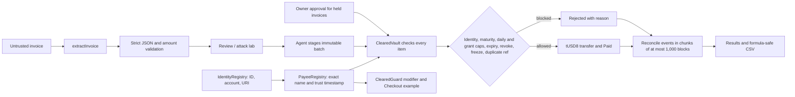

# Cleared

**Your AI can read the invoice. It can't redirect the money.**

Cleared is for **web3 teams and DAOs paying contractor invoices in stablecoins**. Mature verified recipients can be paid by an agent without an owner signature, within contract-enforced limits. New recipients and changed payment addresses are held for owner approval.

> Cleared lets an AI agent prepare and pay your stablecoin invoices, but the contract, not the AI, decides who can be paid: a poisoned invoice can fool the model and still can't move a cent to a lookalike.

Aevum Builder Challenge #1, primary track: Native AI Assistants. Current status: local source implementation and tests. Public hosting, Aevum deployment and transaction evidence are **TODO**. No deployment, publishing or network transaction was performed for this task.

## Try without a wallet

Open **/try** on a running Cleared instance. No wallet, API key or visitor installation is required. It loads three sample invoices automatically. Public instance URL: **TODO after authorized hosting**.

1. Simulate automatic payment: two mature contractors are allowed, the lookalike is rejected.
2. Select a new recipient or changed address. See **PayeeOnHold** and its remaining time. The agent cannot clear it; owner approval can.
3. Freeze demo payments with the kill switch. Both automatic and owner-approved payments are blocked.
4. Open **/attack**, choose a pre-generated lookalike and enable hidden instructions. Edit the invoice yourself.
5. Compare extracted fields with the payment decision. The local ledger reads **attacks attempted / cents lost: 0** because the page never sends funds. It is a browser-local simulation counter, not a public security metric.

If public Aevum contract addresses are configured, /try also offers read-only contract checks using eth_call. They are separate from the sample simulation and produce no transaction receipt. RPC failures are shown as errors.

## The first 30 seconds

| Time    | Opening and action                                                                                                                                                                                          |
| ------- | ----------------------------------------------------------------------------------------------------------------------------------------------------------------------------------------------------------- |
| 0-7 s   | "AI agents now read invoices and pay them. Attackers noticed."                                                                                                                                              |
| 7-14 s  | "Spend caps limit how much. Not to whom."                                                                                                                                                                   |
| 14-20 s | "What if the AI could be fooled and the money still couldn't move?"                                                                                                                                         |
| 20-30 s | Show three invoices, the extracted poisoned address and a red rejection. Show the changed-recipient hold. When testnet evidence exists, finish with two Paid events and one Rejected event in the explorer. |

Until deployment, use the labeled simulation and local tests. Do not present sample output as explorer evidence or a live model failure.

## Run locally

Requirements: Node 24, npm and Foundry. Start from the repository root.

```sh
npm install
npm run dev
```

Open http://127.0.0.1:3000/try yourself. The default network mode is demo; it never consults old local deployment files. PowerShell users may need npm.cmd instead of npm.

For a separate, explicitly local transaction demonstration:

```sh
npm run setup
npm run demo
```

The demo script creates a fresh loopback Anvil chain 31337 using Shanghai, mock six-decimal tokens and unlocked test accounts, then starts the web server with CLEARED_NETWORK=local. It refuses an occupied port rather than resetting someone else's node. Stop with Ctrl+C. It is tooling for later local use; it was not run as part of the no-deploy task.

In /app, load samples, stage as the agent, and choose automatic execution or connect the Anvil owner to approve. /app/keys exposes grant limits, expiry, revoke, daily budget and the kill switch. Rejected items must be reviewed and staged again after an executed batch; the batch itself is single-use.

## Architecture



### Risk-based autonomy

- PayeeRegistry has a fixed **trustDelay of 24 hours**. First verification, payment-address changes, and removal followed by re-registration restart the hold. Document or metadata updates at the same address preserve maturity.
- The treasury owner verifies exact UTF-8 names, accounts and optional document hashes. A payee resolves through the registry's IdentityRegistry; agents cannot modify either registry.
- stageBatch stores at most 50 immutable items and records whether each was held when staged. agentExecute is callable only by that batch's agent. It pays eligible items without an owner signature.
- A held-at-stage item still requires owner approval after time passes. A fresh review and batch may use the now-mature identity. The current registry and hold are always rechecked during execution.
- approveAndExecute permits the owner to clear a hold. It cannot bypass identity mismatch, grant caps, daily cap, expiry, revoke, duplicate references, insufficient balance or a freeze.
- The daily cap is shared by all agents and owner-approved agent batches. It resets at **00:00 UTC**, using block.timestamp / 1 days. Grant renewal does not reset daily spend. Lowering the cap below spend leaves zero remaining for that day.
- The kill switch freezes **all agent-originated payments**, including pending batches approved by the owner. Owner withdrawals remain available. Only the owner may freeze or resume.
- Agent grants have total and per-invoice limits, expiry, revocation and a version. A new grant resets its grant spend and invalidates its pending batches; daily accounting persists.
- Policy failures emit Rejected per item. Valid items emit Paid. Transfer failure reverts the entire execution atomically. State changes precede transfers, with a reentrancy lock.
- Invoice references are unique across the vault. SDK references hash JSON.stringify([name, reference]). Reconciliation also checks payee, amount and document hash and does not count one event twice.

### Identity and reusable guard

IdentityRegistry provides incrementing agent/payee IDs resolving to an account, metadata URI and account revision. PayeeRegistry owns its identity directory and exposes owner-controlled registerWithMetadata and registerAgent. Removed payees retain their identity audit trail but fail verification.

This is an **ERC-8004-style minimal directory**, not a complete implementation of [ERC-8004](https://eips.ethereum.org/EIPS/eip-8004). It does not provide the standard's transferable ERC-721 identities, wallet ownership proofs, reputation or validation registries. No claim of full compliance or "first on Aevum" is made.

The workspace packages are MIT source packages and have **not been published to npm**:

| Package        | Builder interface                                                                                       |
| -------------- | ------------------------------------------------------------------------------------------------------- |
| @cleared/sdk   | Chain definitions, ABIs, exact amounts, stage, autoPay, approve, freeze, risk review, reconcile and CSV |
| @cleared/guard | isClearedPayee / assertClearedPayee helpers and abstract Solidity ClearedGuard with onlyClearedPayee    |

```ts
import { stage, autoPay, approve, reconcile, toCsv } from "@cleared/sdk";
import { assertClearedPayee } from "@cleared/guard";

await assertClearedPayee(publicClient, registry, invoice.name, invoice.payee);
const stageHash = await stage(agentWallet, vault, items);
// Wait for a successful receipt and read Staged.batchId.
const executionHash = await autoPay(agentWallet, vault, batchId);
// Held invoices instead use approve(ownerWallet, vault, batchId).
const receipt = await publicClient.waitForTransactionReceipt({
  hash: executionHash,
});
if (receipt.status !== "success") throw new Error("Execution reverted");
const rows = await reconcile(
  publicClient,
  vault,
  invoices,
  deployBlock,
  receipt.blockNumber,
  batchId,
);
const csv = toCsv(rows);
```

Write helpers use legacy transactions. Preflight helpers are advisory; the paying contract must check identity again. See contracts/src/Checkout.sol for a user-paid transferFrom example guarded with onlyClearedPayee. The modifier enforces destination matching only; caller permissions, trust delays and treasury budgets belong in the integrating application. ClearedVault enforces those additional controls.

## Extraction: live model or saved sample

extractInvoice() is the shared extraction boundary for /attack and the invoice parser. The supported HTTP provider is Anthropic's [Messages API](https://platform.claude.com/docs/en/api/messages/create). Only server process variables are used. No credentials are required for the demo.

| Variable                                       | Meaning                                                                                     |
| ---------------------------------------------- | ------------------------------------------------------------------------------------------- |
| LLM_PROVIDER                                   | anthropic enables the supported provider                                                    |
| LLM_API_KEY                                    | Server-only credential; never returned by /api/config                                       |
| LLM_MODEL                                      | Provider model ID; default claude-haiku-4-5-20251001                                        |
| CLEARED_NETWORK                                | demo by default, or local / aevum                                                           |
| CLEARED_VAULT, CLEARED_REGISTRY, CLEARED_AGENT | Public testnet addresses; vault alone also selects Aevum mode, but all are needed for reads |
| CLEARED_DEPLOY_BLOCK                           | Start block for efficient reconciliation                                                    |
| DEPLOYER_PRIVATE_KEY                           | Reserved for the prepared Foundry script; unused by the web and this task                   |

.env.example contains placeholders only. Configure environment through your own server process. Nothing reads a private key for the demo. Never give server credentials a NEXT_PUBLIC prefix.

- Live extraction requires explicit UI opt-in. Invoice text is then sent to the provider. The prompt treats document instructions as untrusted; the payment contract is still the authority.
- Input is bounded to **20,000 characters**, output to 600 tokens, response size is checked, and a 20-second timeout applies. JSON must contain exactly reference, name, payee, amount and currency. Amount is a positive decimal string with at most six fractional digits in uint256 range; currency must be tUSD8. Names are bounded to 160 UTF-8 bytes. Unknown fields, malformed addresses, Markdown and truncated responses are rejected.
- Without a key, exact attack fixtures replay **authored saved fields**, explicitly labeled cached illustration. These are staged demonstrations, not captured live-model responses. Editing input prevents an unrelated cached result from being replayed; labeled TXT templates use deterministic extraction instead.
- Freeform extraction requires the live provider. Provider failures are surfaced; they do not silently become a fake live success. A model may resist an attack. The UI only calls it fooled when the extracted sample vendor has a changed destination, and identifies whether the output was live or staged.
- Unit tests use synthetic credentials and mocked fetch only. No real LLM, paid API or Aevum RPC is called in tests. No live-provider reliability claim is made.

The treasury accepts TXT, CSV and text PDFs: at most 10 files, 2 MB each, 10 pages per PDF, 50 invoices per batch. Scanned PDFs/OCR are unsupported. Hashes cover original TXT/PDF bytes; CSV hashes cover serialized row fields. Exact business references prevent repeated payment even across file formats. CSV exports neutralize spreadsheet formulas.

## Aevum compatibility and evidence

Network configuration follows the [Aevum Starter Kit](https://github.com/qday-io/aevum-starter-kit): chain **44005**, HTTPS RPC https://rpc-test.qday.info, explorer https://explorer-test.qday.info, tUSD8 **0x456569838f1d43009A91ebA4263147Afd7233483**, **6 decimals**. Solidity targets **Shanghai**. Writes are **legacy type 0**; event requests span at most **1,000 inclusive blocks**. No WebSocket, Cancun opcodes, Kernel, ERC-4337 bundler or paymaster dependency is required.

contracts/script/DeployAevum.s.sol is prepared and compiled only. Its registry constructor also creates the identity directory. No deployment command was executed for this task. Deployment, verification, initialization and funding require a separate authorized step. Use team-controlled test recipients; the fictional sample addresses are not treasury destinations.

| Required testnet evidence                | Address / transaction / explorer            |
| ---------------------------------------- | ------------------------------------------- |
| IdentityRegistry                         | TODO: deploy, record address and link       |
| PayeeRegistry                            | TODO: deploy, record address and link       |
| ClearedVault                             | TODO: deploy, record address and link       |
| Automatic mature-payee Paid              | TODO: transaction hash and explorer link    |
| Lookalike Rejected(NameMismatch)         | TODO: transaction hash and explorer link    |
| New/changed payee Rejected(PayeeOnHold)  | TODO: transaction hash and explorer link    |
| Owner-approved held-payee Paid           | TODO: transaction hash and explorer link    |
| Kill switch and agent revoke             | TODO: transaction hashes and explorer links |
| Deployment block and exact source commit | TODO after authorized release               |
| Public /try URL and demo recording       | TODO after authorized hosting               |

Existing docs/local-proof.json and docs/local-reconciliation.csv are historical Anvil evidence from the previous milestone. They are not proof of the new autonomy implementation and cannot be found in the Aevum explorer. Current behavior is verified by the executable test suites.

## Eight judging criteria

| Criterion                                     | Implementation                                                                                             | Remaining evidence                                            |
| --------------------------------------------- | ---------------------------------------------------------------------------------------------------------- | ------------------------------------------------------------- |
| 1. User experience and presentation           | English UI, full addresses, explicit risk decisions, hold timer, wallet-free /try                          | Manual desktop/mobile visual review                           |
| 2. Clear and well-structured demo             | Three invoices, editable attack lab, extraction beside decision, freeze scenario                           | Live hosting, testnet receipts and video                      |
| 3. Comprehensive documentation                | Setup, architecture, API packages, reproduction, controls and honest limitations                           | Fill deployment evidence table                                |
| 4. Innovation and originality                 | Destination identity plus staged-held approval, bounded autonomy and adversarial demo                      | Validation with DAO treasurers                                |
| 5. Technical quality and platform integration | Shanghai, legacy transactions, six decimals, chunked logs, tested contracts and minimal identity directory | Aevum deployment and operational checks                       |
| 6. Real-world utility and market potential    | Stablecoin contractor invoices for web3 teams and DAOs; small businesses are a secondary example           | Pilot organizations and accounting integrations               |
| 7. Safety, trust and controls                 | Identity recheck, trust delay, daily/grant caps, expiry, revoke, freeze, unique refs and atomic transfers  | Independent audit and multisig operations                     |
| 8. Ecosystem contribution                     | MIT SDK, Solidity/TS guard, Checkout example, tests and documented Aevum constraints                       | Public repository, package publication and developer feedback |

## Verify

```sh
forge test
npm test
npm run typecheck
npm run build
npm run check:contrast
```

On the existing Windows setup, use the workspace .local/bin/forge.exe if the globally installed Foundry hits restricted-token profile lookup. npm run setup installs official verified tools inside the workspace. The task baseline was **31 Foundry + 43 Vitest tests**; the current result is **66 Foundry + 101 Vitest tests passing**. Exact verification results and changed files are in [the implementation report](docs/verification-aevum-02.md).

The production HTTP smoke in tools/web-smoke.mjs checks five pages, PDF uploads, configuration and a saved attack over loopback without launching a browser. Run a production web server first. No network writes are used by the smoke.

## Security and limitations

This is an unaudited test-token prototype. The owner controls verified identities, grants, freeze, budgets and withdrawals. Registry membership proves owner-approved matching, not a legal identity or delivery of services. A compromised owner can approve a malicious destination; the hold only constrains agent autonomy. A forged invoice naming a legitimate mature recipient may still be paid within budget. Invoice authenticity and work completion require organizational controls.

No background agent scheduler, production relayer, team authentication, multisig integration, EIP-712 approval, persistent event index or reorg checkpoints are included. Automatic execution is permissionless only to the configured batch agent; someone must actually run its wallet transaction. The attack lab never signs or broadcasts. Its ledger is local and editable, not a loss guarantee. eth_call checks current state, not future execution or finality.

Review state is held in page memory. The attack counter uses browser localStorage and can be cleared. The upload and extraction endpoints need authentication, persistent rate limits, request limits before buffering and PDF worker isolation before untrusted public hosting. Provider cost controls must be configured by the operator. No paid provider call or browser interaction was performed for this task; HTTP checks and static rendering do not replace a manual visual and wallet review.

## Roadmap and business hypothesis

1. After authorization: Aevum testnet deployment, owner-controlled recipients, evidence hashes, public hosting and a rehearsed demo.
2. DAO/team pilot: verify contractors and changed-address workflows, integrate invoice queues and accounting exports, adopt multisig ownership.
3. After audit: persistent settlement indexing, reorg handling, authenticated team roles, provider budgets and production monitoring.

Business hypothesis: a subscription per organization for invoice queues, approval policies and accounting exports, with the core SDK and guard remaining open source. No users, revenue or market validation are claimed.

## Credits

**Based on Aevum Starter Kit (MIT, PQA Labs)**: [qday-io/aevum-starter-kit](https://github.com/qday-io/aevum-starter-kit). Adapted network facts and chunked-log strategy; the unmodified upstream MIT license is in NOTICE. Cleared contracts, extraction boundary, SDK, guard, Checkout example, UI and tests are project implementations; the starter's git history and Checkout code were not copied. Project license: LICENSE. Dependency notices: THIRD_PARTY.md.
